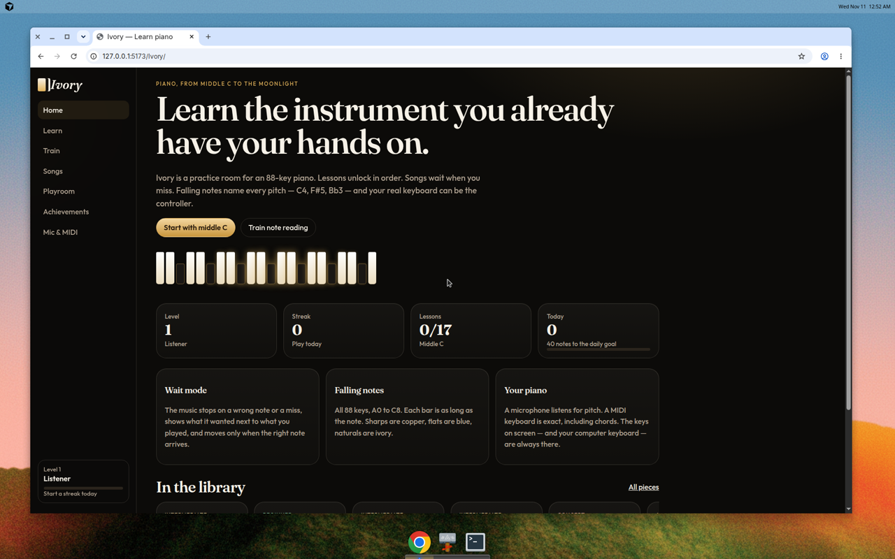
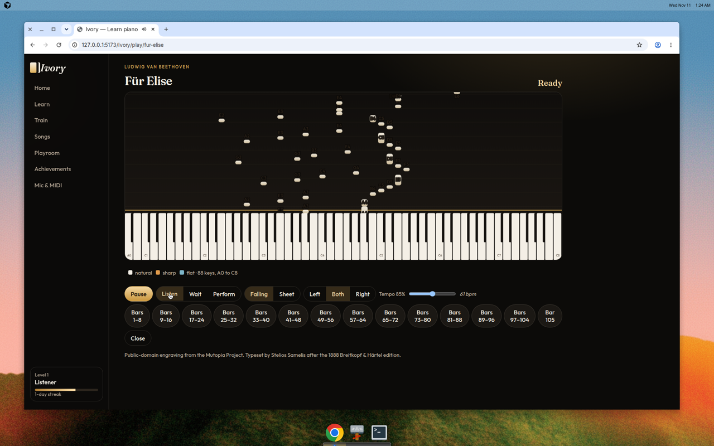
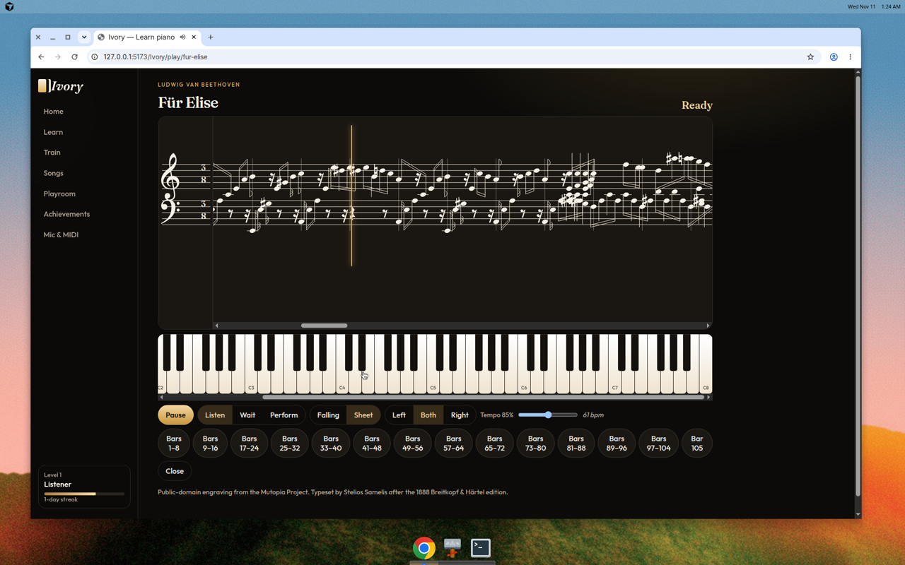
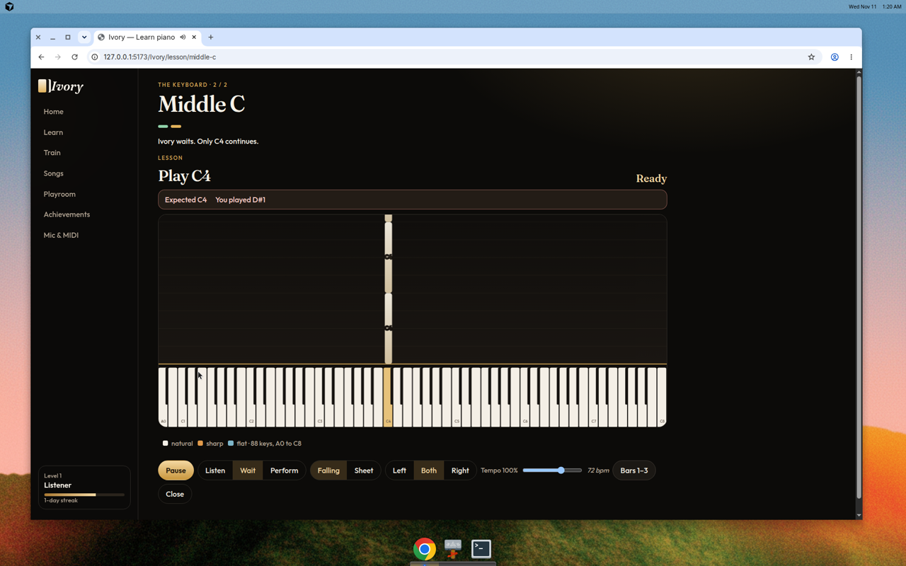
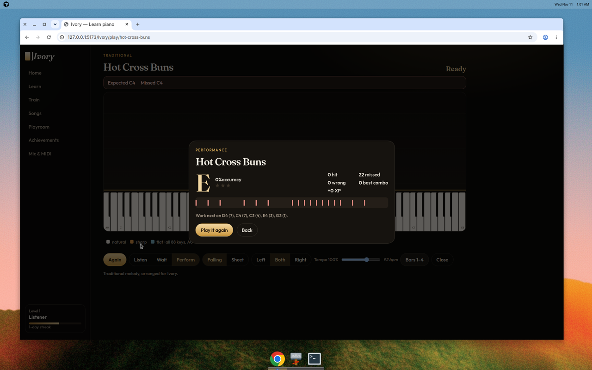
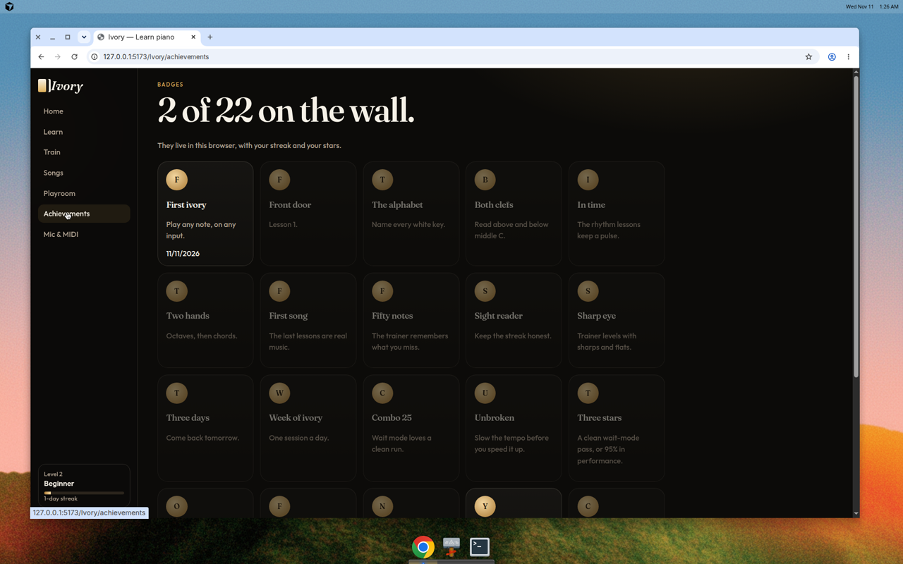

# Ivory

A piano practice room for an 88-key keyboard. Lessons unlock in order, songs wait when you miss, and you can play from a microphone, a MIDI keyboard, the on-screen keys, or the computer keyboard.

Progress stays in this browser. There are no accounts and no server.



## Play

- **Learn** walks from middle C through both clefs, rhythm, chords, and into real pieces. A lesson stays locked until the one before it is finished.
- **Wait mode** stops on a wrong or missed note, shows what was expected next to what you played, and continues only when the right note arrives.
- **Performance mode** keeps going and then grades the run: accuracy, a timeline, stars, and a letter.
- **Two views**, switchable any time:
  - Sheet music on a grand staff.
  - Falling notes across all 88 keys, A0 to C8. Each bar is as long as the note and is labeled with its letter name (`C4`, `F#5`, `Bb3`). Sharps are copper, flats are blue, naturals are ivory.







- **Note reading** drills one note at a time and comes back to the ones you miss.
- **Songs** can be looped by section, slowed down, and practiced hands separately. The library runs from beginner melodies through Für Elise, the Moonlight Sonata, Clair de lune, and the Pathétique.
- **Your own MIDI files** can be dropped onto the library. They become playable in both views and both modes.
- **XP, levels, streaks, badges, and stars** are saved in `localStorage`. Uploaded pieces are saved in IndexedDB.





## Run it

```bash
npm install
npm test
npm run dev
```

The dev server uses the same `/Ivory/` base path as GitHub Pages, so open `http://localhost:5173/Ivory/`.

```bash
npm run build
npm run preview
```

## GitHub Pages

The site is built to be served at [https://micahthepro.github.io/Ivory/](https://micahthepro.github.io/Ivory/). Vite’s `base` is `/Ivory/`.

Publishing does not use a GitHub Actions workflow. `npm run deploy:branch` builds `dist/` and pushes those files to the root of the `gh-pages` branch, together with an empty `.nojekyll` file and a `404.html` copy of `index.html` so client-side routes survive a refresh.

In the repository, set **Settings → Pages → Build and deployment → Source** to **Deploy from a branch**, branch **gh-pages**, folder **/ (root)**.

A branch deploy still starts GitHub’s built-in `pages-build-deployment` job. If the account is locked for billing, that job will not run and the site will stay unpublished until the lock is cleared.

## Playing a real piano

- **Microphone.** Ivory uses the Web Audio API. One note at a time is reliable, including quiet bass notes within a quarter-tone. Chords are a best effort: thirds and sixths often show up, while octaves and dense chords often collapse into a single pitch. The Mic & MIDI page is a level meter, a cents readout, a noise gate, and an A4 slider (432–446 Hz) so a piano that is not tuned to 440 can still match.
- **MIDI.** If a USB keyboard is plugged in, Web MIDI reads note-on and note-off directly. Chords are exact.
- **Without either.** Click the on-screen keys, or use the computer keyboard. The home row from A is C D E F G A B C D E, the black keys are W E T Y U O P, and Z / X shift the octave.

Wear headphones if the microphone is on and the app is also playing sound, or Ivory will hear itself.

## Where the music comes from

Beginner tunes (Hot Cross Buns, Ode to Joy, Greensleeves, and the rest) are arrangements written for Ivory.

The longer classical pieces are public-domain works, converted from public-domain Mutopia Project MIDI engravings. Credits are stored on each piece and shown under the player.

The three Moonlight Sonata movements are different. The music is public domain. The engraving, by Stewart Holmes for Mutopia, is [CC BY-SA 2.5](https://creativecommons.org/licenses/by-sa/2.5/). Those three JSON files stay under that license. See `public/songs/LICENSE.md`.

Piano sound is the Salamander Grand Piano, sampled by Alexander Holm and used under CC BY 3.0. See `public/samples/ATTRIBUTION.md`. Until a sample has loaded, a small synthesized piano fills in.

Notation uses [Bravura](https://github.com/steinbergmedia/bravura) by Steinberg, under the SIL Open Font License (`licenses/Bravura-OFL.txt`).

## Scripts

| Command | What it does |
| --- | --- |
| `npm test` | Pitch detection, the wait-mode engine, MIDI parsing, and the built-in scores |
| `npm run build` | Typecheck and production build |
| `npm run deploy:branch` | Build and push `dist/` to the `gh-pages` branch |
| `npm run songs` | Rebuild `public/songs` from Mutopia MIDI files in `$MIDIS` (default `/tmp/ivory-midi`) |
